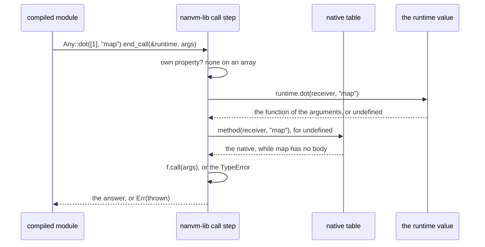

# The runtime

The built-in functions, defined once. [`module.f.js`](./module.f.js)
exports `runtime`, in two sections. Its `member` section holds, by name,
the member functions whose **body** is written, `startsWith`: each a
FunctionalScript function of the receiver alone, answering `undefined`
for a receiver the name is no member of, or the function of the arguments
as the call passed them, `undefined` past the end — the body dispatches on
its receiver's type itself, and an executor asks it in two steps, the
first before any argument exists. Its `static` section holds the static
functions at the path [`../static`](../static/module.f.js) admits each
under — `Object.is` at `static.Object.is` — each a function of the
arguments alone, written here and exported nowhere else: a module calls
the built-in, `Object.is` or `Number.isInteger`, never the body, so the
body is a VM's and the helper a built-in replaced moves in here when the
built-in is admitted. A path every executor binds natively, `Object.entries`,
holds the built-in itself, so every admitted path has a value and the table
is complete as a value. The proof checks every static body against the
host's own built-in at the same path. The design of the static section
is [`../todo/runtime-static.md`](../todo/runtime-static.md). A name
without a body is absent, and each VM answers it from its own native
table. The proposal and the steps still to take are
[`../todo/runtime.md`](../todo/runtime.md).

## Inside the admitted set

Which names a module may call stays
[`../prototype`](../prototype/module.f.js)'s: the prototype name lists and
`prohibitedCalls` for the parser, `allowedCalls` for every executor.
[`types.ts`](./types.ts) pins every key of `member` to that set, and
every entry to a body of the receiver alone, so a body for a name the
language does not admit fails `tsc`, and [`proof.f.mjs`](./proof.f.mjs)
checks the same at run time. Which types a name is a member of is the
body's own first step, `typeof self === 'string'`, not a key of the
table: one function per name, for every receiver. The keys are not the
admitted set and need not be: a table keying every admitted name with a
marker in place of a body would only duplicate the parser's list.

## The names without a body

Two kinds, and both are each VM's to bind natively:

- the **primitives**, which no body can define in terms of the rest — for
  a string, the code-unit read `charCodeAt` and the substring `slice`;
  among the static functions, `Object.entries`, since enumerating keys is
  what no body can do otherwise, which [`../static`](../static/module.f.js)
  lists as `natives`; `length` is a property each value owns and is on no
  list, and an array element is read by a runtime number index, which the
  language has. A member primitive a body needs is an **intrinsic**
  ([`../intrinsic`](../intrinsic/module.f.js)): a function the body calls,
  `slice(self, start, end)` in `found` and `charCodeAt(self, at)` in
  `codePointAt`, whose own body is the one member call and which the
  compiler recognizes whole as a node every executor answers natively, so
  no body of this module makes a member call;
- the names whose body **waits on a primitive the language has not
  admitted** — `toLowerCase` and `toUpperCase` on a string from a code
  unit, `String.fromCharCode`, over which the Unicode case tables are
  written; the number formatters and a nondecimal `toString` radix on
  `BigInt`, over which the exact decimal expansion of a double is written.
  Both arrive with the static-function step.

Every other name is absent only until its body is written; the rest of
the string and array names are the next batches.

## How each VM binds it

A VM answers a call on a receiver in the order the runtime's `dot`
writes once: the receiver's own property, its presence asked by `hasEntry`
so that an own `undefined` is found and its value read by `entry`; else
the **runtime's body**, asked for the receiver alone — the function of
the arguments, which the VM then calls, or `undefined`; else the
`TypeError` for calling `undefined`, with nothing built on the way. A
**native** implementation stands in for a body a name does not have yet,
asked where `dot` answers `undefined`: every VM asks `dot` first and its
natives after, so a body answers its name wherever it is called, and the
native table holds the names without one, which
[`../todo/runtime-members.md`](../todo/runtime-members.md) gives their
bodies one at a time. The guard
of an optional call, `a.startsWith?.(x)`, asks the
same steps before it evaluates `x`, the body's first step among them; a
body is pure, so a guard and a call ask it twice at no cost but the
call.
A native implementation may stand beside a body where the VM measures the
gain; the body is the reference, and the corpus in
[`../../nanvm/member`](../../nanvm/member/module.f.js) checks the native
answer against it. A name without a body keeps the host engine as its
oracle there, as every name had before, until its body lands. The completeness table
[`../../nanvm/methods`](../../nanvm/methods/module.f.mjs) generates counts
a body as an answer: every admitted pair is answered, natively or by a
body, and no other pair is.

- **The represented interpreter** —
  [`edag/value/method`](../../edag/value/method/module.f.mjs) — implements
  most names natively through the host's own built-ins, and the rest from
  the runtime its executor is given: the evaluated `runtime` export, in the
  `runtime` field of an `amnesia` or `memo` context
  ([`edag/operations/types.ts`](../../edag/operations/types.ts)), which
  reaches every function the invocation calls. The transpiler takes it as
  `interpret(load)`, a `RuntimeLoad` run once the root is known to be a
  module; `fjs compile` loads it from the package it runs
  from, `fjs/js/runtime/module.f.js` there, when a data output interprets a
  module and not before; `fjs/nanvm/harness` loads it the same way, from
  the repository root, for the fixture expectations it writes; and the
  compiler's demo, which has no file system, takes the generated EDAG. An
  executor given no runtime answers a body's name with the `TypeError` of a
  VM that binds nothing, never with a host built-in.
- **NaNVM** — `npm run gen` compiles this module to
  `nanvm/lib/src/vm/gen.runtime.rs` through the compiler's runtime
  printer, the compiler being the generator: the `runtime` export as a
  value, `runtime::<A>()`, printed by the ordinary backend as any module
  is, which whoever runs compiled modules builds once and hands each as
  its parameter, and through which a compiled module reads a static and a
  call step asks the body of a name ("How NaNVM finds it" below). No VM
  holds a runtime. The native tables in `vm/lambda` keep every name
  without a body.

The generator also writes the module's EDAG as
`gen.edag.data.mjs` beside it, for the one consumer that needs the runtime
as data without the compiler: the corpus proof
[`../../nanvm/proof.f.mjs`](../../nanvm/proof.f.mjs), which runs every
member-function case through `amnesia` with this runtime and against the
host. Nothing the compiler imports reads a generated file: `npm run gen`
deletes every `gen.*` before it regenerates, and a generator whose own
imports needed one could not start.

## How it is compiled and used

One source, three forms, and each executor runs the one it can:

The host function is what `import` gives and runs on host values only;
the runtime's own proof uses it and nothing else does. The EDAG is what
the interpreter uses: a consumer evaluates it once to the module's export
object and passes that in the executor's context, or, where it already
has the compiler loaded, interprets the source on the spot, as the
harness does. The Rust is what NaNVM binds. Whatever the form, a call
step resolves the same way: the receiver's own property, the runtime's body, the VM's
native implementation for a name without one, the `TypeError`.

## How NaNVM finds it

A compiled module takes the runtime as its parameter,
`pub fn module<A: IVm>(runtime: Any<A>) -> Result<Any<A>, Any<A>>`: the
value `runtime::<A>()` in `nanvm-lib` answers, this module's `runtime`
export printed by the ordinary backend as any module is, which whoever
runs compiled modules — the harness, a program embedding a VM — builds
once and hands to each; two VMs in one process build two. The module
reaches every built-in through it. For `[1].map(() => 5)`, the output is
`Any::dot(c0, string_any("map")).end_call(&runtime, c1)`, and the library
takes it from there:

`Member::call` in `vm/lambda/member.rs` resolves in that order — the
receiver's own property, the runtime value's `dot`, asked for the
receiver and the key and answering the function of the arguments or
`undefined`, the native table in `vm/lambda/method.rs` for a name without
a body, the `TypeError` for calling `undefined` — and the `?.()` guard
asks the same lookups, before any argument is evaluated. A call step on a
member takes `&runtime` for that; a step on a plain value, and a property
read, take none. The order shortens to `dot` alone once every name the
native table answers has a body
([`../todo/runtime-members.md`](../todo/runtime-members.md)).

**A static function is a value with no receiver.** The EDAG spells
`Object.is` as the value `['Object.is']`, and `Number.isInteger` as
`['Number.isInteger']`, and the Rust backend prints the read as
`static_read(&runtime, "Object.is")?`, the value's `static` section
walked by the path: the one closure the value holds there, so every read
is the same function and `===` compares identities, as JavaScript's does,
which `nanvm/harness/fixtures/object-is.mjs` checks on NaNVM against the
interpreter, and `number-predicates.mjs` for the `Number` predicates over
every kind of value. A path the value holds no function at is refused,
never answered with `undefined`: the parser admits a static only from
[`../static`](../static/module.f.js), and the represented interpreter,
reading its context's runtime through `functionAt`, fails naming the path
where a runtime lacks it. `Object.entries` has no body: the `static`
section lists it as the built-in itself, the represented interpreter
answers it with a function value of its own, `edag/value/entries`, and in
NaNVM's value it is a closure over `Any::entries`
(`nanvm/harness/fixtures/object-entries.mjs`). The completeness test in
`vm/lambda/method.rs` checks every path `../static` admits is a function
of the value.

**Where the runtime rides.** A closure captures nothing from the Rust
scope around it, so a function body that reaches a built-in — a member
call, a static read, in it or in a function it makes — holds the runtime
in its frame, one slot after its own, and reads it as `A::frame(self_)[k]`
as it reads any slot; a module whose scope reaches none takes its
parameter as `_runtime`, so every module has the one signature.

**The runtime module itself is printed with no runtime in scope.** The
runtime printer, [`fjs/compiler/rust/runtime`](../../compiler/rust/runtime/module.f.mjs),
hands this module's `runtime` export to the same backend, into
`pub fn runtime<A: IStaticFunction>() -> Result<Any<A>, Any<A>>`, with
two differences. Every function the `static` and `member` sections name
carries the NativeFunction text of its path, `function is() { [native
code] }`, in place of its body's, since a runtime function is the
built-in, not its body — the represented interpreter spells the same text
from the static node, `staticText` in `fjs/edag`, and `object-is.mjs`
holds the two to one text; a helper no section names, `found`, keeps its
body's, and so does `dot`, which no program reaches. And a member
call or a read of a static function this module defines, anywhere in it,
is refused by name, since the scope has no runtime to dispatch through:
the core may not use what it defines. A body reaches a native through an
intrinsic, `slice`, whose call step asks no runtime, `end_call_native`,
and another body by reading it as a value. `gen.runtime.rs` is included
into the crate by `#[path]`, which is why it says `use nanvm_lib::…` and
the crate declares `extern crate self as nanvm_lib`.

Nothing is held by the library and no VM binds anything: a VM is a value
representation, and the runtime is a value a module is given. A VM that
wants a native implementation of a name that has a body substitutes it by
a measured change to the call step's order
([DESIGN.md §13](../../../doc/DESIGN.md#13-one-source-of-truth-optimize-by-substitution));
the table is asked after `dot`, so an entry beside a body is unreachable.

## Two invariants

The shape is a bootstrap — the compiler writes the runtime, and a
compiled compiler runs under it — and two invariants keep it from being a
cycle:

- **Compiling needs no runtime; only running does.** Parsing and lowering
  run no body. The host engine runs the compiler as JavaScript, its own
  built-ins answering the compiler's `.map` and `.slice`, so `npm run gen`
  can delete every generated file and still write the runtime's EDAG and
  Rust from source. A runtime is needed to *run*: an executor evaluating a
  module whose initialization calls a body's name, or the compiler itself
  once compiled and run on a VM, where the runtime the previous compiler
  wrote is the fixed point. An optimizing pass that evaluated at compile
  time would be the one place the compiler runs bodies; it takes the
  runtime as an input, as the executors do, and folds nothing a body
  answers when given none, so the runtime is always compiled with no
  runtime, whatever the pass does elsewhere.
- **Nothing in the runtime calls a member function or reads a static
  function: no initializer, and no body.** The module builds closures and
  nothing else, and so does every module it imports, transitively — a
  helper shared with the rest of `fjs/` must hold this too, or be inlined —
  so the runtime can be interpreted from nothing. Loading it from source
  relies on exactly that: `runtimeAt` interprets it under `noRuntime`, so a
  member call or a static read in any initializer of the closure fails the
  load rather than passing unnoticed. A body reaches a native through an
  intrinsic, `slice` in `found` or `charCodeAt` in `codePointAt`, called
  as a function ([`../intrinsic`](../intrinsic/module.f.js)), and another
  body by
  reading it as a value, never by its name: the core may not use what it
  defines, and the whole module is the core, which the proof checks on the
  compiled EDAG — no chain step and no static node anywhere in it. This is
  what lets NaNVM hold the runtime as a value its bodies never name: the
  runtime printer prints the module with no runtime in scope, so a member
  call or a static read anywhere in it, body or initializer, is the
  backend's refusal, by name ("How NaNVM finds it").

## Giving a name its body

1. Write the body here — a function of the receiver, `undefined` for a
   receiver the name is no member of and the function of the arguments
   otherwise — with its proof case by case, and `npm start compile`
   accepting the module.
2. Remove the interpreter's native case in `edag/value/method`, so the
   body is what answers it there.
3. Remove NaNVM's entry in `vm/lambda` and the typed method under it:
   `dot` is asked first, so the entry is unreachable once the body exists,
   and the completeness test counts the body as the answer.
4. `npm run gen`, then the corpus: the name's cases in `nanvm/member` run
   the body through `amnesia` and on NaNVM.

`startsWith` is the first; `codePointAt`, over the intrinsic `charCodeAt`,
the second.
