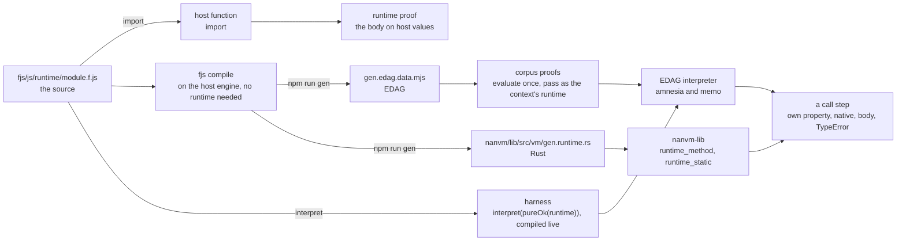
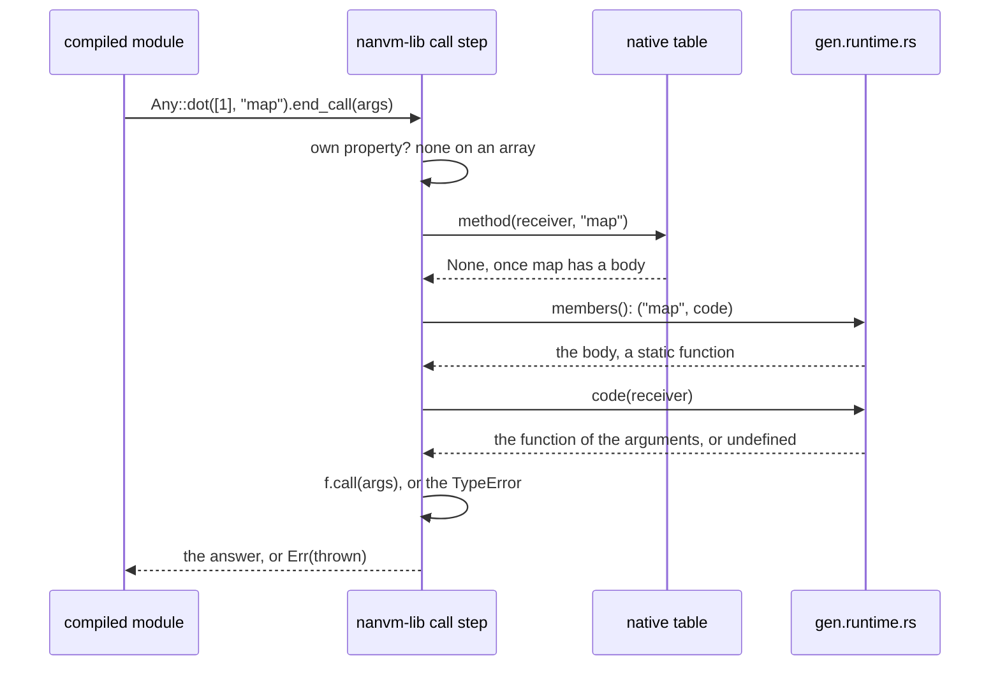

# The runtime

The built-in functions, defined once. [`module.f.js`](./module.f.js)
exports `runtime`, in two sections. Its `member` section holds, by name,
the member functions whose **body** is written, `startsWith`: each a
FunctionalScript function of the receiver alone, answering `undefined`
for a receiver the name is no member of, or the function of the arguments
as the call passed them, `undefined` past the end — the body dispatches on
its receiver's type itself, and an executor asks it in two steps, the
first before any argument exists. Its `static` section holds the static
functions at the path [`../static`](../static/module.f.js) admits each
under — `Object.is` at `static.Object.is` — each a function of the
arguments alone, written here and exported nowhere else: a module calls
the built-in, `Object.is` or `Number.isInteger`, never the body, so the
body is a VM's and the helper a built-in replaced moves in here when the
built-in is admitted. The proof checks every static body against the
host's own built-in at the same path. The design of the static section
is [`../todo/runtime-static.md`](../todo/runtime-static.md). A name
without a body is absent, and each VM answers it from its own native
table. The proposal and the steps still to take are
[`../todo/runtime.md`](../todo/runtime.md).

## Inside the admitted set

Which names a module may call stays
[`../prototype`](../prototype/module.f.js)'s: the prototype name lists and
`prohibitedCalls` for the parser, `allowedCalls` for every executor.
[`types.ts`](./types.ts) pins every key of `member` to that set, and
every entry to a body of the receiver alone, so a body for a name the
language does not admit fails `tsc`, and [`proof.f.mjs`](./proof.f.mjs)
checks the same at run time. Which types a name is a member of is the
body's own first step, `typeof self === 'string'`, not a key of the
table: one function per name, for every receiver. The keys are not the
admitted set and need not be: a table keying every admitted name with a
marker in place of a body would only duplicate the parser's list.

## The names without a body

Two kinds, and both are each VM's to bind natively:

- the **primitives**, which no body can define in terms of the rest — for
  a string, the code-unit read `charCodeAt` and the substring `slice`;
  among the static functions, `Object.entries`, since enumerating keys is
  what no body can do otherwise, which [`../static`](../static/module.f.js)
  lists as `natives`; `length` is a property each value owns and is on no
  list, and an array element is read by a runtime number index, which the
  language has;
- the names whose body **waits on a primitive the language has not
  admitted** — `toLowerCase` and `toUpperCase` on a string from a code
  unit, `String.fromCharCode`, over which the Unicode case tables are
  written; the number formatters and a nondecimal `toString` radix on
  `BigInt`, over which the exact decimal expansion of a double is written.
  Both arrive with the static-function step.

Every other name is absent only until its body is written; the rest of
the string and array names are the next batches.

## How each VM binds it

A VM answers a call on a receiver it does not own in this order: the
receiver's own property, then its **native** implementation of the name,
then the **runtime's body**, asked for the receiver alone — the function
of the arguments, which the VM then calls, or `undefined` — then the
`TypeError` for calling `undefined`. The guard of an optional call,
`a.startsWith?.(x)`, asks the same three before it evaluates `x`, the
body's first step among them; a body is pure, so a guard and a call ask
it twice at no cost but the call.
A native implementation may stand beside a body where the VM measures the
gain; the body is the reference, and the corpus in
[`../../nanvm/member`](../../nanvm/member/module.f.js) checks the native
answer against it. A name without a body keeps the host engine as its
oracle there, as every name had before, until its body lands. The completeness table
[`../../nanvm/methods`](../../nanvm/methods/module.f.mjs) generates counts
a body as an answer: every admitted pair is answered, natively or by a
body, and no other pair is.

- **The represented interpreter** —
  [`edag/value/method`](../../edag/value/method/module.f.mjs) — implements
  most names natively through the host's own built-ins, and the rest from
  the runtime its executor is given: the evaluated `runtime` export, in the
  `runtime` field of an `amnesia` or `memo` context
  ([`edag/operations/types.ts`](../../edag/operations/types.ts)), which
  reaches every function the invocation calls. The transpiler takes it as
  `interpret(load)`, a `RuntimeLoad` run once the root is known to be a
  module; `fjs compile` loads it from the package it runs
  from, `fjs/js/runtime/module.f.js` there, when a data output interprets a
  module and not before; `fjs/nanvm/harness` loads it the same way, from
  the repository root, for the fixture expectations it writes; and the
  compiler's demo, which has no file system, takes the generated EDAG. An
  executor given no runtime answers a body's name with the `TypeError` of a
  VM that binds nothing, never with a host built-in.
- **NaNVM** — `npm run gen` compiles this module to
  `nanvm/lib/src/vm/gen.runtime.rs` through the compiler's static-runtime
  printer, the compiler being the generator: every body a static Rust
  function, a static built-in's with an accessor answering its descriptor
  and a member's the code alone, bound on `IStaticFunction` since its
  answer is a closure over the receiver, and two tables by name, which
  `nanvm-lib`'s `runtime_method` and `runtime_static` search for every
  VM. Nothing is evaluated and no VM holds a runtime. The native
  tables in `vm/lambda` keep every name without a body.

The generator also writes the module's EDAG as
`gen.edag.data.mjs` beside it, for the one consumer that needs the runtime
as data without the compiler: the corpus proof
[`../../nanvm/proof.f.mjs`](../../nanvm/proof.f.mjs), which runs every
member-function case through `amnesia` with this runtime and against the
host. Nothing the compiler imports reads a generated file: `npm run gen`
deletes every `gen.*` before it regenerates, and a generator whose own
imports needed one could not start.

## How it is compiled and used

One source, three forms, and each executor runs the one it can:

The host function is what `import` gives and runs on host values only;
the runtime's own proof uses it and nothing else does. The EDAG is what
the interpreter uses: a consumer evaluates it once to the module's export
object and passes that in the executor's context, or, where it already
has the compiler loaded, interprets the source on the spot, as the
harness does. The Rust is what NaNVM binds. Whatever the form, a call
step resolves the same way: the receiver's own property, the VM's native
implementation, the runtime's body, the `TypeError`.

## How NaNVM finds it

A compiled module never names the runtime. It names `nanvm-lib`'s API and
the VM type parameter `A`, and the runtime is static code in `nanvm-lib`
itself, which every VM reaches. For `[1].map(() => 5)`, the output is
`Any::dot(c0, string_any("map")).end_call(c1)`, and the library takes it
from there:

`Member::call` in `vm/lambda/member.rs` resolves in that order — the
receiver's own property, the native table in `vm/lambda/method.rs`, the
runtime's body through `runtime_method`, asked for the receiver and then
called, the `TypeError` for calling `undefined` — and the `?.()` guard
asks the same lookups, the body's first step included, to decide whether
a callee exists, before any argument is evaluated. A member's body is a
Rust function of the receiver answering a function value or `undefined`,
and nothing more: the language never reads a member as a value, so none
has a descriptor, a `length` or a text, and a call step asks the code the
table holds.

**A static function is a value with no receiver.** The EDAG spells
`Object.is` as the value `['Object.is']`, and `Number.isInteger` as
`['Number.isInteger']`, and the Rust backend prints each as its accessor's
value, `Function::from(object_is::<A>()).to_any()`, an item of
`nanvm_lib::vm` the compiled runtime defines: no lookup, no `Result`, and
a module naming a static the runtime lacks does not compile. The parser
admits a static only from [`../static`](../static/module.f.js), and the
represented interpreter, reading its context's runtime through
`functionAt`, fails naming the path where a runtime lacks it, never
answering `undefined`. Every read answers one function, as in JavaScript:
a built-in is a static function identified by its name, so two reads are
two handles to one function and `===` compares the names — not the
handles, since a descriptor is a promoted constant, which Rust compiles
once per crate that instantiates it and once per codegen unit where it is
inlined, so two handles to one built-in may be two addresses, and a pointer
comparison would hold in a debug build, which shares instantiations across
crates, and fail in a release build, which does not —
which `nanvm/harness/fixtures/object-is.mjs` checks on NaNVM against the
interpreter, and `nanvm/harness/fixtures/number-predicates.mjs` for the
`Number` predicates over every kind of value. `Object.entries` has no
body: the represented interpreter answers it with a function value of its
own, `edag/value/entries`, and NaNVM's is a built-in written in
`vm/runtime.rs`, `vm::object_entries`, listed in the `statics` table
beside the bodies (`nanvm/harness/fixtures/object-entries.mjs`). The
completeness test checks every path [`../static`](../static/module.f.js)
admits is bound.

**The runtime is static code, not a value.** The static-runtime printer,
[`fjs/compiler/rust/runtime`](../../compiler/rust/runtime/module.f.mjs),
reads this module at compile time rather than printing a scope that
evaluates it: every module-level function becomes a static `fn` of its
arguments alone — a static built-in and a helper a body reads as a value
with an accessor answering its descriptor, the built-in's name, code,
length and text, as a promoted constant; a member the `fn` alone, bound
on `IStaticFunction` since its answer is the function of the arguments, a
closure over the receiver, which a body may not read as a value — a frame
slot resolves to another function's accessor or to an inlined literal; an
import's read of its export object, `{ isNegativeZero }.isNegativeZero`,
folds to the function it holds; and the `runtime` export object is read as
the table of built-ins, a static one named `Object.is` and a member one
`startsWith`, and printed nowhere. So this module's scope
holds **functions and literals**: an object or an array a body would
capture is refused, naming the node, and so is a function a static's body
makes at call time, since a static is bound on `IVm` alone. A body may call
another body, through a member call or by reading it as a value — `is`
reads `isNaN_` — and both resolve to static functions. `gen.runtime.rs`
is included into the crate by `#[path]`, which is why it says
`use nanvm_lib::…` and the crate declares `extern crate self as nanvm_lib`.
A built-in's text, `String(f)`, is the NativeFunction text ECMA-262
requires of one, `function is() { [native code] }`, never its body's: a
runtime function is the built-in, not its body. NaNVM forms it from the
descriptor's name, `Function::text`, so no descriptor carries a text, and
the represented interpreter from the static node, `staticText` in
`fjs/edag`; `nanvm/harness/fixtures/object-is.mjs` and
`number-predicates.mjs` hold the two to one text.

Nothing is held, so nothing is initialized and no VM binds anything: a
VM is a value representation, and the runtime reaches it as library code
does. A VM that wants a native implementation of a name that has a body
adds it to the native table, which a call step asks first.

## Two invariants

The shape is a bootstrap — the compiler writes the runtime, and a
compiled compiler runs under it — and two invariants keep it from being a
cycle:

- **Compiling needs no runtime; only running does.** Parsing and lowering
  run no body. The host engine runs the compiler as JavaScript, its own
  built-ins answering the compiler's `.map` and `.slice`, so `npm run gen`
  can delete every generated file and still write the runtime's EDAG and
  Rust from source. A runtime is needed to *run*: an executor evaluating a
  module whose initialization calls a body's name, or the compiler itself
  once compiled and run on a VM, where the runtime the previous compiler
  wrote is the fixed point. An optimizing pass that evaluated at compile
  time would be the one place the compiler runs bodies; it takes the
  runtime as an input, as the executors do, and folds nothing a body
  answers when given none, so the runtime is always compiled with no
  runtime, whatever the pass does elsewhere.
- **No initializer in the runtime's closure calls a member function or
  reads a static function.** The module builds closures and nothing else,
  and so does every module it imports, transitively — a helper shared with
  the rest of `fjs/` must hold this too, or be inlined — so the runtime can
  be interpreted from nothing. Loading it from source relies on exactly
  that: `runtimeAt` interprets it under `noRuntime`, so a member call or a
  static read in any initializer of the closure fails the load rather than
  passing unnoticed. NaNVM holds it as a stronger rule: the static-runtime
  printer lifts the module at compile time, so its scope holds functions
  and literals, and an initializer that computes anything cannot be lifted
  and is refused.

## Giving a name its body

1. Write the body here — a function of the receiver, `undefined` for a
   receiver the name is no member of and the function of the arguments
   otherwise — with its proof case by case, and `npm start compile`
   accepting the module.
2. Remove the interpreter's native case in `edag/value/method`, so the
   body is what answers it there.
3. Remove NaNVM's entry in `vm/lambda` and the typed method under it, or
   keep it as an optimization with a measurement that justifies it.
4. `npm run gen`, then the corpus: the name's cases in `nanvm/member` run
   the body through `amnesia` and on NaNVM.

`startsWith` is the first.
