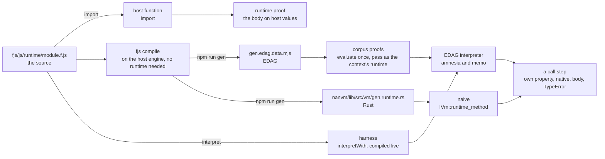

# The runtime

The built-in member functions, defined once. [`module.f.js`](./module.f.js)
exports `runtime`: for a receiver type, the names whose **body** is
written, each a FunctionalScript function of the receiver and then the
arguments as the call passed them, `undefined` past the end. A name
without a body is absent, and each VM answers it from its own native
table. The proposal and the steps still to take are
[`../todo/runtime.md`](../todo/runtime.md).

## Inside the admitted set

Which names a module may call stays
[`../prototype`](../prototype/module.f.js)'s: the prototype name lists and
`prohibitedCalls` for the parser, `allowedCalls` for every executor.
[`types.ts`](./types.ts) pins every key here to that set — each type the
table keys is a receiver type, each key under it an allowed name on that
type's prototype — so a body for a name the language does not admit, or
on the wrong type, fails `tsc`, and [`proof.f.mjs`](./proof.f.mjs) checks
the same at run time. The keys are not the admitted set and need not be:
nothing in a `.f.js` enumerates an object's keys, so a list could not be
derived from them, and a table keying every admitted name with a marker
in place of a body would only duplicate the parser's list.

## The names without a body

Two kinds, and both are each VM's to bind natively:

- the **primitives**, which no body can define in terms of the rest — for
  a string, the code-unit read `charCodeAt` and the substring `slice`;
  `length` is a property each value owns and is on no list, and an array
  element is read by a runtime number index, which the language has;
- the names whose body **waits on a primitive the language has not
  admitted** — `toLowerCase` and `toUpperCase` on a string from a code
  unit, `String.fromCharCode`, over which the Unicode case tables are
  written; the number formatters and a nondecimal `toString` radix on
  `BigInt`, over which the exact decimal expansion of a double is written.
  Both arrive with the static-function step.

Every other name is absent only until its body is written; the rest of
the string and array names are the next batches.

## How each VM binds it

A VM answers a call on a receiver it does not own in this order: the
receiver's own property, then its **native** implementation of the name,
then the **runtime's body**, then the `TypeError` for calling `undefined`.
A native implementation may stand beside a body where the VM measures the
gain; the body is the reference, and the corpus in
[`../../nanvm/member`](../../nanvm/member/module.f.js) checks the native
answer against it. The completeness table
[`../../nanvm/methods`](../../nanvm/methods/module.f.mjs) generates counts
a body as an answer: every admitted pair is answered, natively or by a
body, and no other pair is.

- **The represented interpreter** —
  [`edag/value/method`](../../edag/value/method/module.f.mjs) — implements
  most names natively through the host's own built-ins, and the rest from
  the runtime its executor is given: the evaluated `runtime` export, in the
  `runtime` field of an `amnesia` or `memo` context
  ([`edag/operations/types.ts`](../../edag/operations/types.ts)), which
  reaches every function the invocation calls. The transpiler takes it as
  `interpretWith(runtime)`, and `fjs/nanvm/harness` loads it from this
  module's source for the fixture expectations it writes. An executor given
  no runtime answers a body's name with the `TypeError` of a VM that binds
  nothing, never with a host built-in.
- **NaNVM** — `npm run gen` compiles this module to
  `nanvm/lib/src/vm/gen.runtime.rs` through the Rust backend, the compiler
  being the generator, and `nanvm-lib`'s `IVm::runtime_method` is the hook
  a VM binds it through: `naive` answers it by reading the compiled
  object's entry for the receiver's type and the key, and a VM without
  static functions, which cannot run a body, binds nothing. The native
  tables in `vm/lambda` keep every name without a body.

The generator also writes the module's EDAG as
`gen.edag.data.mjs` beside it, for the one consumer that needs the runtime
as data without the compiler: the corpus proof
[`../../nanvm/proof.f.mjs`](../../nanvm/proof.f.mjs), which runs every
member-function case through `amnesia` with this runtime and against the
host. Nothing the compiler imports reads a generated file: `npm run gen`
deletes every `gen.*` before it regenerates, and a generator whose own
imports needed one could not start.

## How it is compiled and used

One source, three forms, and each executor runs the one it can:

The host function is what `import` gives and runs on host values only;
the runtime's own proof uses it and nothing else does. The EDAG is what
the interpreter uses: a consumer evaluates it once to the module's export
object and passes that in the executor's context, or, where it already
has the compiler loaded, interprets the source on the spot, as the
harness does. The Rust is what NaNVM binds. Whatever the form, a call
step resolves the same way: the receiver's own property, the VM's native
implementation, the runtime's body, the `TypeError`.

## Two invariants

The shape is a bootstrap — the compiler writes the runtime, and a
compiled compiler runs under it — and two invariants keep it from being a
cycle:

- **Compiling needs no runtime; only running does.** Parsing and lowering
  run no body. The host engine runs the compiler as JavaScript, its own
  built-ins answering the compiler's `.map` and `.slice`, so `npm run gen`
  can delete every generated file and still write the runtime's EDAG and
  Rust from source. A runtime is needed to *run*: an executor evaluating a
  module whose initialization calls a body's name, or the compiler itself
  once compiled and run on a VM, where the runtime the previous compiler
  wrote is the fixed point. An optimizing pass that evaluated at compile
  time would be the one place the compiler runs bodies; it takes the
  runtime as an input, as the executors do, and folds nothing a body
  answers when given none, so the runtime is always compiled with no
  runtime, whatever the pass does elsewhere.
- **The runtime's initialization calls no member function.** It builds
  closures and nothing else, so it can be interpreted from nothing, which
  is what loading it from source relies on.

## Giving a name its body

1. Write the body here, with its proof case by case, and `npm start
   compile` accepting the module.
2. Remove the interpreter's native case in `edag/value/method`, so the
   body is what answers it there.
3. Remove NaNVM's entry in `vm/lambda` and the typed method under it, or
   keep it as an optimization with a measurement that justifies it.
4. `npm run gen`, then the corpus: the name's cases in `nanvm/member` run
   the body through `amnesia` and on NaNVM.

`startsWith` is the first.
